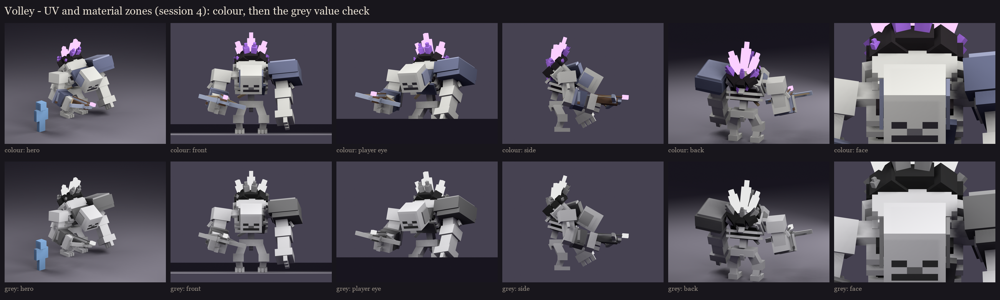

# Volley redesign, session 4: UV and material blocking

The session 3 rig, UV-mapped and filled with one flat colour per material zone. The vanilla skeleton face is now
painted on the skull as flat zones (each vanilla pixel doubled to 2x2 texels), replacing the dark insets of sessions
1-3. Session 5 paints over this atlas.

## UVs

- **One texel per model unit** (16 per block, the vanilla density) on every face. Every cube size is whole, so no
  face is stretched; the script refuses to run if one isn't.
- **690 face islands, every one unique**, each with a 1-pixel border that repeats its edge so filtering never pulls
  in a neighbour. No mirrored sharing, so the left arm can wear differently from the right later.
- **Atlas: 256 x 512** ([occultech_volley.png](occultech_volley.png), [enlarged](atlas_preview.png)). The faces need
  about 66,000 texels including borders, slightly more than a 256 x 256 atlas holds. The other option was sharing UV
  space between mirrored limbs. 282 of the 512 rows are used; the rest is room for the phase and damage variants
  (session 6). **This goes past the 256 x 256 default in the style rules, so it needs your OK.**

## Zones and values ([uv_report.json](uv_report.json))

| Zone | RGB | Value (L*) | Saturation |
|---|---|---|---|
| bone | 198, 198, 192 | 80 | 0.03 |
| face_dark | 54, 50, 58 | 21 | 0.14 |
| face_nose | 112, 110, 114 | 47 | 0.04 |
| marrow | 58, 50, 54 | 22 | 0.14 |
| armour | 98, 103, 127 | 44 | 0.23 |
| chain | 145, 150, 173 | 62 | 0.16 |
| steel | 150, 158, 176 | 65 | 0.15 |
| wood | 112, 86, 66 | 39 | 0.41 |
| string | 168, 148, 118 | 62 | 0.3 |
| basalt | 38, 32, 36 | 13 | 0.16 |
| calcite | 239, 231, 212 | 92 | 0.11 |
| crystal | 167, 113, 220 | 57 | 0.49 |
| glow | 214, 179, 251 | 78 | 0.29 |

- **Value check:** every pair of zones that touch on the model differs by at least 12 L*. The lit crystals are
  the brightest violet, the unlit ones a step darker, and the basalt rim the darkest thing on the model, so the
  geode reads in grey too.
- **Colour:** violet is the only strongly coloured thing (crystal 0.49). The wood and string were muted to keep it
  that way. The armour is darker slate than the steel of the arbalest, so the weapon reads apart from the armour.
- **The renders:** Blender's colour curve pushes the lit shards towards white. In game, BetterModel draws a `glow`
  bone at full brightness in its texture colour, so expect a clear violet. The in-game check is the real test.
- **Bone:** vanilla's cool grey-white makes the body the lightest mass. That fits a skeleton (the vanilla read you
  asked for), but it's the opposite of the "dark body, glowing magic" default in the style notes; session 5 adds
  form shading, grime and darker joints to keep the crystals the focus.

## In game

The review model `occultech_volley_rig` now carries this atlas (same commands as session 3). After `/bm reload` it
shows the real pixel size: check that the texels match vanilla mobs' density, and that the face reads from 10 blocks.

Regenerate: `python tools/art/bosses/volley_crone_s4.py`.
