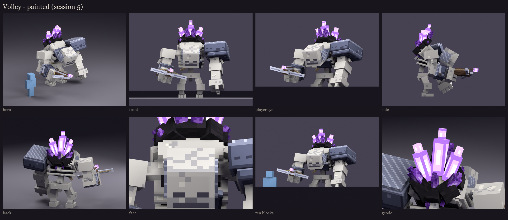

# Volley redesign, session 5: texture painting

The session 4 atlas, fully painted: the same UV islands on the same 256 x 512 atlas. These are offline renders; the
in-game look is the real review.

- **Skull:** vanilla's own skeleton head texture on every side of the skull and jaw, each vanilla pixel doubled and
  re-coloured into Volley's bone ramp, so vanilla's light-dark pattern is kept exactly. The jaw carries vanilla's
  mouth and chin rows.
- **Ramps:** hue-shifted, so shadows lean violet-blue and lights lean warm. Each zone uses 2-4 tones in clusters,
  never single-pixel speckle.
- **Form, not light:** nothing is painted lit from one side; Minecraft shades faces by direction itself. The texture
  carries:
  - ambient occlusion baked from the real geometry (a texel darkens where another part is close in front of it:
    armpits, under the pauldron, between the ribs, at the geode's base);
  - darker joint ends on the long bones;
  - grime low on the large upright bone faces;
  - lit top edges on the armour plates and the ribs.
- **Detail by material:**
  - bone: a few short cracks with a lit lip, light pitting;
  - armour: scratches, tarnish heavier low down, lit plate edges;
  - chain: staggered 2x2 rings;
  - wood: grain along the stock, and knots;
  - basalt: vertical streaks; calcite: soft clouds;
  - amethyst: a lit diagonal facet band and dark edges on every shard;
  - glowing shards and bolt tip: a near-white core inside bright violet (full-bright in game, the `glow_crystals`
    bone).
- **At 10 blocks** (about the size he is on a 1080p screen at that distance), the skull face, the pauldron, the
  arbalest and the violet geode all read; the bone detail drops out, as it should.

The first pass was too busy: heavy pitting, grime and dark cracks made the bone look camouflaged, and the chain was
single-pixel dots. Both were calmed before this review.

In game: the review model `occultech_volley_rig` carries this atlas. After `/bm reload`, use the same commands as
session 3 (`/bm test occultech_volley_rig idle`, and so on).

Regenerate: `python tools/art/bosses/volley_crone_s5.py`. It reads the vanilla skeleton texture from the installed
26.2 client jar; the jar itself is never copied into the repository.

Next (session 6): fixes from this review, phase and damage variants (part swaps and tints, using the free half of the
atlas), and readability checks at night and under the red damage tint.
