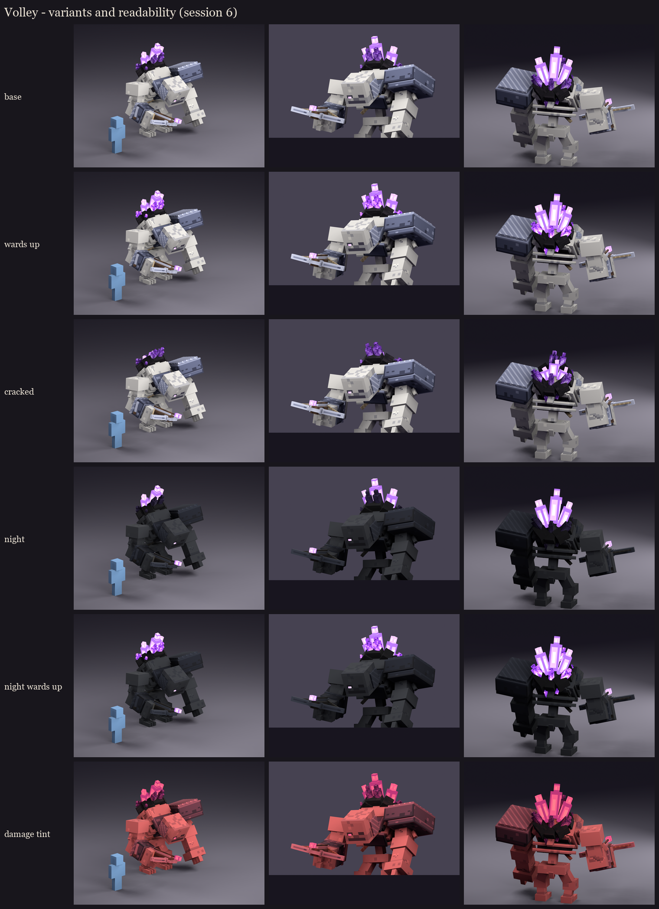

# Volley redesign, session 6: polish, variants and readability

Volley has no phases, so his variants follow the fight. Each one is a real switch on the model, flipped by a Mythic
skill through BetterModel's mechanics, not a second texture set.



| State | What changes | Switch (Mythic skill, wired up in session 8) |
|---|---|---|
| base | as he spawns | `model{m=occultech_volley}` on spawn |
| wards up | every shard lights while an amethyst ward stands | `brightness{m=occultech_volley;p=crystals_back;b=15;s=15}` on `VOLLEY_WARDS_PREPARE`, reset when the last ward breaks |
| cracked | below 40% health the three big glowing shards snap off: stumps with glowing cores | `partvisibility{p=glow_crystals;v=false}` + `partvisibility{p=glow_crystals_broken;v=true}` on a new `CRACKED` action |

New parts:
- `glow_eye`: one small amethyst glint in his right eye slit, half sunk into the socket. It's the single face light
  from the redesign plan, and it keeps a face on him at night.
- `glow_crystals_broken`: the stumps, hidden until the cracked switch. Each is the lower third of a big shard with a
  chipped splinter standing off the break. They don't cast ambient occlusion while hidden.

## Readability

- **Night** (about light level 4: everything except the full-bright parts dims): the bone and armour sink into the
  dark. The geode, the eye glint and the bolt tip still mark where he stands and which way he faces. With the wards
  up the whole crystal crown lights, so the "he's protected" cue reads best exactly when it matters.
- **Damage tint** (BetterModel's red flash on hit): the whole model reads red, the crystals pink. Nothing important
  vanishes.
- These renders are stand-ins: the atlas is darkened or tinted, not lit by Minecraft. The in-game check under real
  night lighting is the true test.

## Cost

122 cubes, **63 display entities**: the eye glint adds one, and the hidden stumps still exist as displays while
invisible. That is up from 56 in session 3; sharing shard angles could bring it back down if the server needs it.

## In game

```
/bm reload
/bm test occultech_volley_rig idle            # as he spawns: the eye glint, the full geode
/bm test occultech_volley_rig_cracked idle    # the cracked variant
```

Try both at night and in daylight. The wards-up brightness can only be tested once the Mythic skill is wired up
(session 8).

Regenerate: `python tools/art/bosses/volley_crone_s6.py`.

Next (session 7): animation. Idle (a breathing hunch), walk, spawn, the windlass wind-up timed to the 1-second warning,
the burst, the wards flare, stagger and death, each matched to Volley's real mechanic timings.
