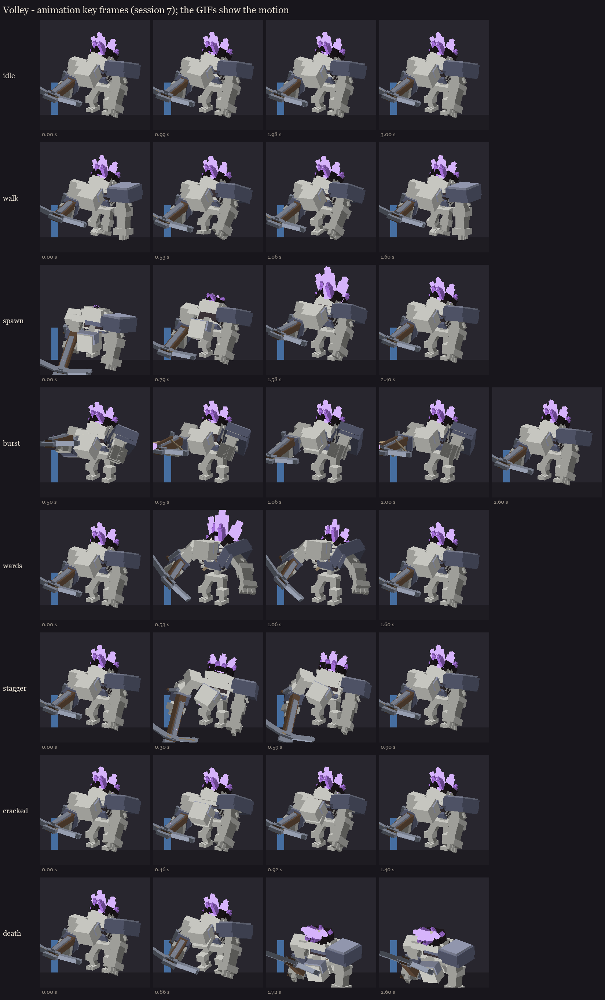
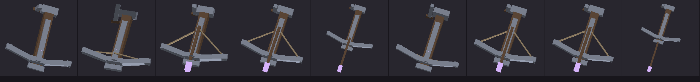

# Volley redesign, session 7: animation

**Revision after the first review:**
- the chainmail hood now sits flush on the skull, and the gorget sits lower and further back, so nothing clips the
  face or the jaw, closed or fully open;
- the arbalest is 1.45x larger (about 3.3 blocks across the prod, 3.9 long);
- the burst now shows the crossbow being loaded and shot (string halves and the bolt are their own bones).

Eight clips, keyed on the session 6 painted rig. Animation is cosmetic: every hit, telegraph and timing still comes
from `Volley.java`, and each clip starts on the server event that starts the attack.



GIF previews (a quick software render, for judging motion, not looks): [idle](gifs/idle.gif), [walk](gifs/walk.gif),
[spawn](gifs/spawn.gif), [burst](gifs/burst.gif), [wards](gifs/wards.gif), [stagger](gifs/stagger.gif),
[cracked](gifs/cracked.gif), [death](gifs/death.gif).

| Clip | Length | Plays | Started by | What happens |
|---|---|---|---|---|
| idle | 3.0 s loop | BetterModel, automatically | - | breathing hunch, three counting clicks of the jaw, the geode pulses |
| walk | 1.6 s loop | BetterModel, while moving | - | heavy lumber, waist sway, the left knuckles swing low |
| spawn | 2.4 s | BetterModel, when the model appears | the ritual's summon | uncurls, the geode grows out of the hump, the head comes up last, a hiss of the jaw |
| burst | 2.6 s | Mythic `state{s=burst}` | `VOLLEY_BURST_PREPARE` | see the timing below |
| wards | 1.6 s | Mythic | `VOLLEY_WARDS_PREPARE` | rears up, the geode flares (scale bounce) as the wards rise |
| stagger | 0.9 s | Mythic | the last ward shatters (new action) | twists away, the head lolls |
| cracked | 1.4 s | Mythic | health below 40% (new action) | a shudder; the big shards snap (part swap from session 6) |
| death | 2.6 s, holds | BetterModel, on death | - | a last rearing cry, then he folds onto his knees, the arbalest drops |

**Burst timing, against Volley.java** (`VOLLEY_WARNING` 20 ticks, then one arrow per 5-tick step). The arbalest is
carried **unloaded** in every other clip (string slack against the prod, no bolt), so the loading reads:

| Time | Server | Animation |
|---|---|---|
| 0.0 s | `BURST_PREPARE`: glows, crank sound | prepare: settles into the crank pose by 0.3 s |
| 0.35-0.85 s | (warning) | loading: the windlass turns twice and draws the string back; an amethyst bolt grows into the groove |
| 1.0 s | `BURST_CONTACT`: first arrow | commit: snaps up to aim, the string snaps forward, the bolt flies off the muzzle |
| each shot (1.0, 1.25, 1.5, 1.75, 2.0 s) | an arrow | release + bolt away, a forearm kick, one counting click of the jaw; then within 0.2 s the windlass whirls a turn, the string is redrawn and the next bolt grows in |
| 2.0-2.6 s | burst over | recover to idle; the arbalest stays unloaded |



The weapon alone through the whole burst: [burst_arbalest.gif](gifs/burst_arbalest.gif).

The arrows leave from the carrier's eye (about 1.7 blocks up), which is the height of the raised arbalest in the aim
pose, so the visible shot and the real one line up.

## In game

The review model `occultech_volley_rig` carries the clips (the six held poses from session 3 are still there).

```
/bm reload
/bm test occultech_volley_rig burst
/bm test occultech_volley_rig wards
/bm test occultech_volley_rig death
```

The same goes for idle, walk, spawn, stagger and cracked. Please check:
- Every clip bends the right way. This is the first real test of the animation sign convention from session 3: if
  arms or the head turn backwards, I flip it.
- The burst feels like a wind-up, then five shots.
- Death doesn't sink badly into the floor.

Known simplifications:
- the spawn starts a little into the ground, as if rising out of the ritual;
- the stagger's arbalest dips to the floor for a moment.

Regenerate: `python tools/art/bosses/volley_crone_s7.py`.

Next (session 8): the new model replaces the shipped one, the Mythic skills play these clips and switch the variants
(wards-up brightness, cracked part swap), the pack is rebuilt and published (with your go-ahead), and the in-game
review.
