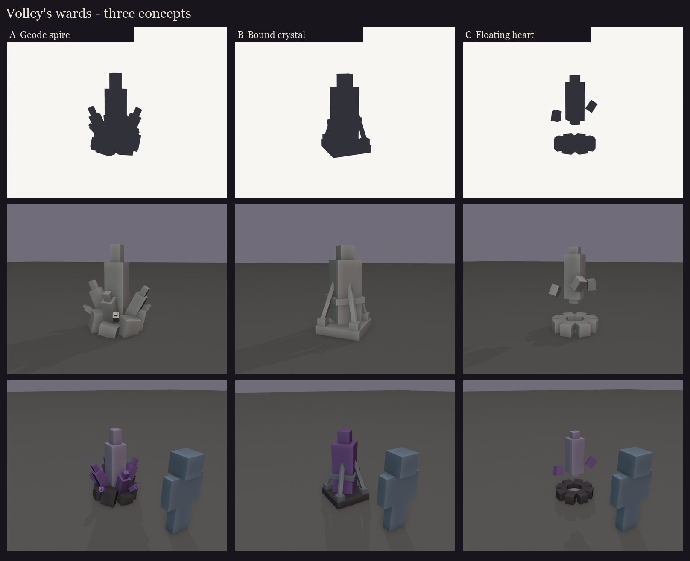

# Volley's amethyst wards, session 1: concepts

Volley raises two wards at a time (every 15 s if none stand). Each takes 4 hits. While one stands he takes 70% less
damage and a violet beam links it to him. Today a ward is the vanilla amethyst-cluster item on a billboard, scaled
1.4, over a 1.26-block hitbox.

These replace that look. Unlike the crystals on his back, a ward is a **target**, so it must read as "break me":
- one bright glowing core;
- the beam's anchor at its top;
- one piece lost per hit, so the 4 hits show on the model.

| | Concept | Size | The 4 hits | Fit with Volley |
|---|---|---|---|---|
| A | **Geode spire**: a cracked geode erupting from the floor, one tall glowing shard ringed by four smaller ones | 1.5 x 2.0 x 1.4 blocks | one ring shard breaks per hit, the core shatters on the 4th | the same geode as his hump: pieces of him planted in the arena |
| B | **Bound crystal**: one big crystal staked to a cracked slab by iron staples and chains, a rune band round it | 1.0 x 1.9 x 1.0 | one chain snaps per hit; the 4th frees and shatters the crystal | echoes his armour and chain; reads as "a sealed thing to break" |
| C | **Floating heart**: a basalt bowl with a double-pointed crystal hovering above it, three chips orbiting | 1.2 x 1.9 x 1.2 | one orbiting chip falls per hit, the 4th drops and breaks the heart | the most magical; the hovering heart is the clearest target and beam anchor |

Sheets: [A](A/sheet.png), [B](B/sheet.png), [C](C/sheet.png). Regenerate: `python tools/art/bosses/volley_ward_s1.py`.

Planned for the chosen ward (sessions 2-7 condensed, it's a prop):
- blockout, hitbox (about 1.4 x 2 blocks, up from 1.26);
- texture in Volley's palette and geode layers;
- clips: rise (grows out of the floor), idle (core pulse), hit (a shudder as a piece breaks), shatter;
- the beam anchored at the core's tip.
