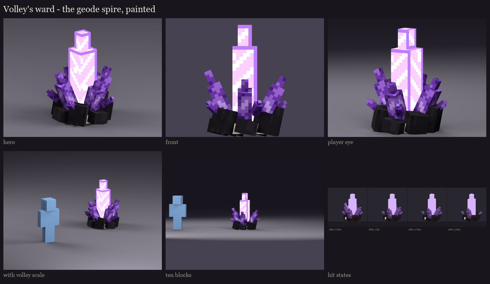

# Volley's amethyst ward: the geode spire (blockout, paint, animation)

Concept A, chosen in the [concept review](../s1_concepts/README.md): a cracked geode erupting from the floor, the
same geode as Volley's hump. It's a prop, so sessions 2-7 ran as one pass on Volley's tools.



- **Size:** 1.5 x 2.0 x 1.4 blocks; 26 cubes in 17 displays.
- **Atlas:** 128 x 128 ([texture](occultech_volley_ward.png), [enlarged](atlas_preview.png)), painted by Volley's
  painter: his ramps, baked ambient occlusion, faceted amethyst.
- **Parts:**
  - `base`: the basalt crust, calcite and four small buds;
  - `glow_core`: the tall glowing shard, full-bright; the beam to Volley leaves from its tip, about 1.8 blocks up;
  - `shard_0`-`shard_3`: the four ring shards.
- **Hits:** players hit the server's own invisible hitbox, as today, resized in session 8 to about 1.4 x 2 blocks.
  Hits 1-3 each hide one ring shard (part visibility); the 4th plays the shatter. The first three states are in the
  sheet.
- **Glow:** the lit amethyst (here and on Volley's glowing shards) is now painted with the same diagonal facets as
  the other crystals, a step brighter, instead of concentric "window" frames. The offline renderer overexposes it;
  in game it shows as pale violet with bright bands.

| Clip | Length | Plays | What happens |
|---|---|---|---|
| rise | 1.0 s | when the ward appears | the crust pushes up out of the floor, the ring shards grow one after another, the core last with an overshoot |
| idle | 2.0 s loop | always | the core pulses, the ring shards sway a little |
| hit | 0.3 s | each of hits 1-3 | a shudder and a flash of the core, as a shard snaps off |
| shatter | 0.6 s, holds | the 4th hit | the core flares and collapses, the remaining shards fly outward and vanish, the crust sinks |

GIFs (a software preview for motion): [rise](gifs/rise.gif), [idle](gifs/idle.gif), [hit](gifs/hit.gif),
[shatter](gifs/shatter.gif).

In game (review model already in the test server's BetterModel folder):

```
/bm reload
/bm test occultech_volley_ward rise
/bm test occultech_volley_ward idle
/bm test occultech_volley_ward shatter
```

Then copy `run/plugins/BetterModel/build.zip` over the "Occultech BetterModel test" pack (or ask me) and press F3+T.

Regenerate: `python tools/art/bosses/volley_ward_s2.py`.
