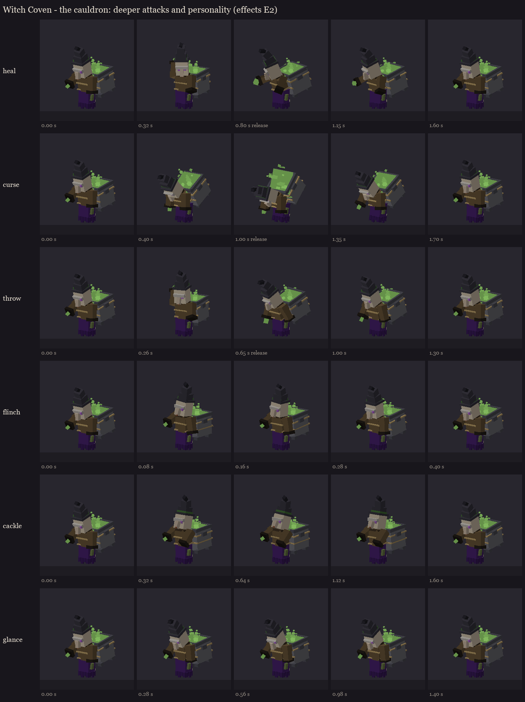
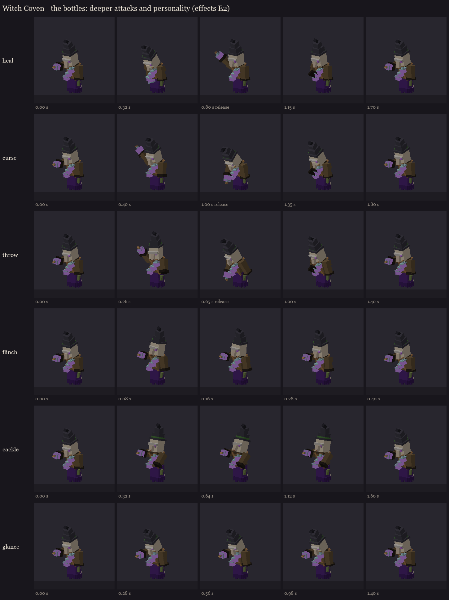
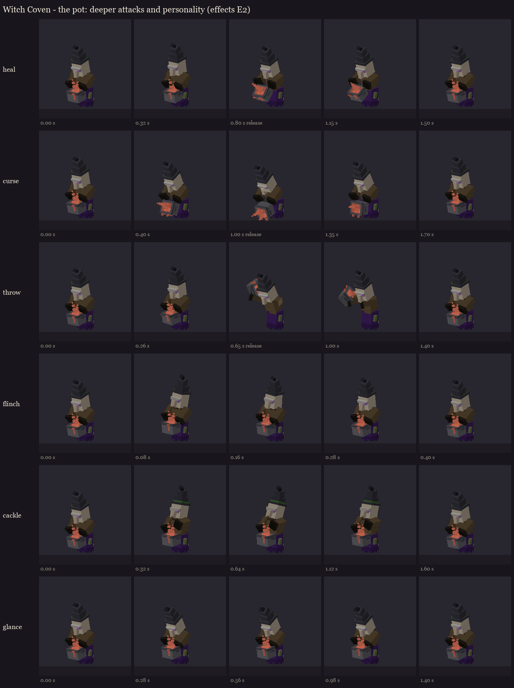

# Witch Coven effects, E2: deeper attacks and personality

Session 7's idle, walk, spawn, rotation and death clips stay. This replaces heal, curse and throw with deeper
versions per sister and adds three personality clips. Each attack now has three beats:
- **anticipation:** a reach back, a dip, or drawing the bottle in;
- **contact:** a snap on the release;
- **follow-through.**

Secondary motion runs on top: the hat's tip and tier lag behind her body, the robe swings, and the brew sloshes in
its vessel (it dips as she scoops, drops as she pours, empties as the pot is flung). The release points are
unchanged (heal 0.8 s, curse 1.0 s, throw 0.65 s), so the fight's timing from session 7 still holds.

| | The cauldron | The bottles | The pot |
|---|---|---|---|
| **heal** | reaches back over her shoulder into the cauldron, scoops (the brew dips), sweeps it out to her sister with a twist; her sleeve's cast flares | draws the bottle down to her chest, raises it high and lobs it, then reaches across to her belt and draws a fresh one | hugs the pot in, then tips it forward and pours a long stream, the brew level dropping |
| **curse** | bows deeper and deeper through the warning until the brew sloshes over her shoulder onto the mark | winds up and aims, trembling, through the warning; smashes a bottle on the mark; draws a fresh one | tips the pot further and further, trembling, then pours it out onto the mark |
| **throw** | reaches back into the cauldron, scoops a glob, swings it up and hurls it, lunging | winds up and hurls, then draws a fresh bottle from the belt | dips, heaves the pot up beside her head and flings the wave; the pot empties, then refills |

**Personality, the same for every sister:**
- **flinch** (0.4 s): she recoils when hit and her hat jolts. It's layered over whatever she's doing.
- **cackle** (1.6 s): her head is thrown back, her shoulders shake, the hat's tip flops.
- **glance** (1.4 s): at a fallen sister. The server turns her toward the body, and the clip lowers her head and lets
  her arms drop. Never during an attack.

**The belt stays full:**
- The bottle witch's held bottle shrinks to nothing the moment it leaves her sleeve.
- It grows back as her sleeve comes away from the belt.
- The animation does all of it, with no extra fight code.

**Fixed on the way:** the pot witch's throw first swung the pot across her face. Its overshoot swung inward, and
the throw's torso twist turned the heaved pot back over her head. She now leans without twisting, and the heave goes
further out and up. It's checked from the front and the side.

Key frames for each sister (releases marked), and GIFs in each sister's `gifs/` folder:





The rigs on your server have every clip, and loaded on the second test server with no warnings:

```
/bm reload
/bm test occultech_coven_bottles_rig heal
/bm test occultech_coven_pot_rig throw
/bm test occultech_coven_cauldron_rig cackle
```

Regenerate with `python tools/art/bosses/coven_e2.py`. It builds on the session 7 rigs and copies the result to your
server.
