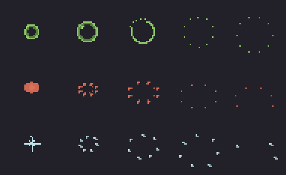

# Witch Coven effects, E3: particles, sprites, the throwables in the pack, and the cosmetic skills

E3 builds every piece the effects need. Session 8 wires them into the fight, so every effect starts on the server's
real event.

## Three custom burst sprites

Five frames each, drawn in greys and tinted per call, played from the first frame (AirEffects `Burst`, now with
`BUBBLE`, `DROPLETS` and `SHARDS`). They're drawn in `tools/art/session_o5.py` and packed like the other bursts.

- **bubble:** a bubble with a highlight swells, splits open, and its film flies apart as a ring of tiny drops.
- **droplets:** a splat, then teardrop drops flung out on arcs, falling and thinning.
- **shards:** a white flash, then angular glass shards spinning out, each with a bright edge, falling and glinting
  out.

## The throwables and the hat as item models

`coven_fx_glob`, `coven_fx_bottle`, `coven_fx_wave` and `coven_fx_hat` are E1's models as resource-pack item models
(`tools/art/bosses/coven_fx_items.py`, saved with the other plugin-shown parts in `docs/art/session-g`):
- one element per cube, inside the -16..32 bounds, each keeping its single-axis turn;
- **only the brew's faces carry the dye tint**, so the role colour colours the brew and leaves the glass, cork and
  felt as painted;
- the brew glows.

## The cosmetic Mythic skills

`src/main/mythic/Skills/WitchCoven.yml` has 39 skills (`tools/art/bosses/coven_mythic_skills.py`). It's look and
sound only, like Volley's and Brood Mother's. Each sister (`COVEN_CAULDRON_*`, `COVEN_BOTTLES_*`, `COVEN_POT_*`)
gets:

| Skill | What it does |
|---|---|
| `SPAWN` | the arrival clip, witch particles, a low witch cackle |
| `BECOMES_HEALER`, `_CURSER`, `_BOMBER` | the rotation clip; at the strike (12 ticks) her brew takes the role tint, with a puff of the new colour and a brewing-stand chime; 12 ticks later the tint is applied again, after any hit flash (session 6) |
| `BECOMES_SPENT` | a dead sister's brew goes grey |
| `HEAL` | the clip; at the release (16 ticks) a stream of green motes runs to the sister she heals, green motes and sparkles rise round her, and the witch drink sound plays. The bottle witch's heal adds breaking glass, the pot witch's a pouring trickle |
| `CURSE` | the clip; witch particles swirl on the marked player through the 20-tick warning (the cauldron witch's brew drips purple as she bows); at 20 ticks a purple burst and smoke on the mark, and a spell sound |
| `THROW` | the clip; at the release (13 ticks) the throw sound and a puff of red at her sleeve |
| `FLINCH`, `CACKLE`, `GLANCE` | the personality clips (the cackle with a witch's laugh) |
| `DEATH` | the slump, the brew going spent grey, the witch's death sound, smoke |
| `HOVER` | a few motes of ash under her hem, on a timer |

The file is written but not yet in the Mythic pack installer's list. It names the shipped models, which only exist
after session 8, so session 8 adds it with the coven's Mythic mob file.

## For session 8: what the plugin draws

The plugin knows the roles and the potions, so it draws these with `AirEffects` and `FloorDecals`:

- **The throwables:**
  - When a witch throws, an item display of her throwable (`coven_fx_glob`, `coven_fx_bottle` or `coven_fx_wave`),
    dyed the bomber red, rides the real splash potion each tick and spins: the bottle end over end, the glob and the
    wave slowly.
  - Where the potion breaks:
    - the glob: a `DROPLETS` burst and the existing splash decal;
    - the bottle: a glass-tinted `SHARDS` burst and a red `DROPLETS` burst;
    - the wave: a wide `SPLASH` with `DROPLETS` and a short steaming puddle.

  The real potion still does the hit.
- **Ambient brew:** every second or so, a `BUBBLE` burst in her current role colour pops above each witch's vessel.
- **Heal:** a green `BUBBLE` burst on the healed sister as the Mythic stream reaches her.
- **Curse:**
  - All three witches use the existing `CURSE` mark (the warning).
  - **The cauldron witch:** a purple spill decal runs from her toward the mark.
  - **The bottle witch:** at the landing, a glass `SHARDS` burst and purple `DROPLETS` on the mark.
  - **The pot witch:** a purple puddle spreads onto the mark and fades.
  - None of these deal damage: only players still on the mark are cursed (plan.md).
- **The role swap:** a thin streak in the new colours (`AirEffects.Streak`) runs from each sister to the next and
  fires.
- **Death:**
  - a spent-grey puddle spills from her vessel and fades;
  - her hat (`coven_fx_hat`) drops beside her, tilted, and goes with the fight;
  - the survivors are turned toward her and play `GLANCE`, but never during an attack.
- **Personality:**
  - `FLINCH` when she's hit;
  - `CACKLE` when a player in the fight dies, and now and then when she's idle.

Regenerate:
- `python tools/art/session_o5.py bursts` (the sprites);
- `python tools/art/bosses/coven_fx_items.py` (the item models);
- `python tools/art/bosses/coven_mythic_skills.py` (the skills).
