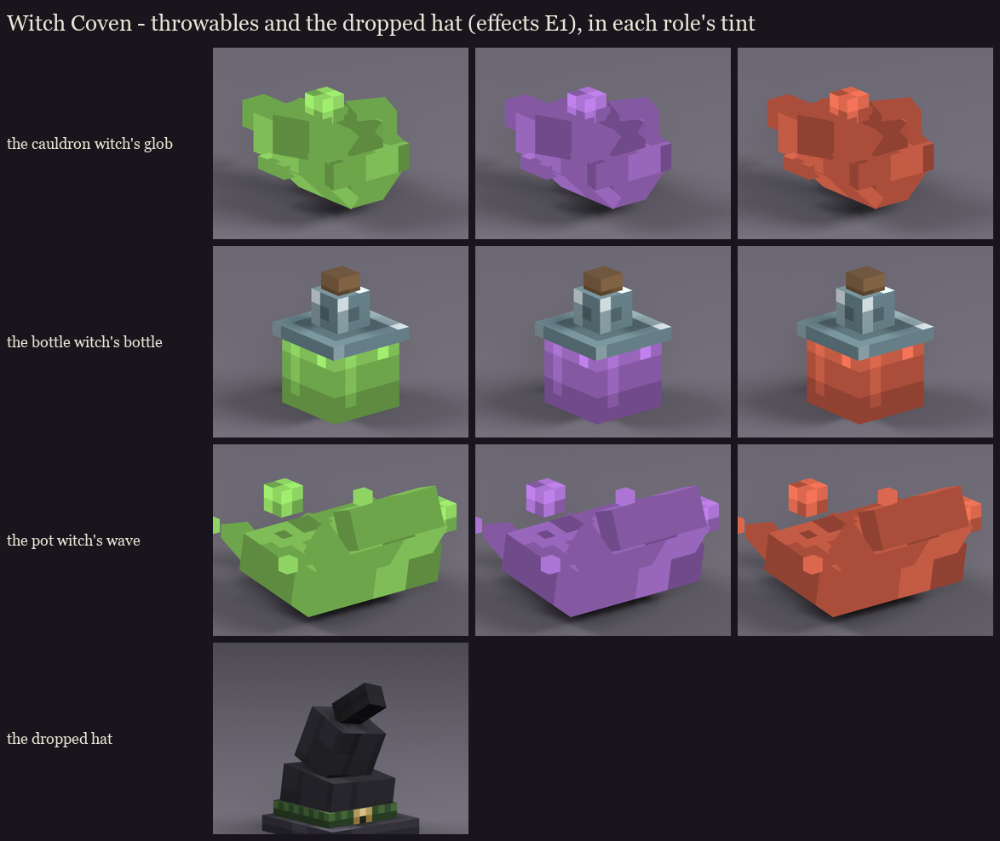

# Witch Coven effects, E1: the throwables and the dropped hat

Agreed after session 7 ([../plan.md](../plan.md), "Effects and deeper attacks"): each witch throws her own thing.

**How they work:** the real splash potion stays the invisible carrier, so the hit logic and its label don't change.
The model rides on it and tumbles. The brew parts are painted in session 5's neutral greys, so they take the role
tint like the witches' brew. They're shown here in all three role colours.

| Model | | Cubes | In flight |
|---|---|---|---|
| **glob** | the cauldron witch's glob of brew, scooped from the cauldron: a rounded core with lumps on its back, a tail streaming behind it, drops flung off the sides, a bubble breaking out | 14 | turns as it flies ([glob_tumble.gif](glob_tumble.gif)) |
| **bottle** | the bottle witch's bottle, the same as the ones on her belt so it reads as hers: brew, glass shoulder, neck, cork | 4 | tumbles end over end ([bottle_tumble.gif](bottle_tumble.gif)) |
| **wave** | the pot witch's wave: a thin sheet of brew heaved out of the pot, its crest curling over at the front, tendrils and spray flung back | 11 | turns slowly, heavy ([wave_tumble.gif](wave_tumble.gif)) |
| **hat** | the witch's hat (vanilla's at 1.45x, as she wears it), coming off as she slumps and landing beside her | 5 | none: dropped on death |

**Painting:** one small atlas ([occultech_coven_fx.png](occultech_coven_fx.png)) painted with session 5's painters
at one texel per unit:
- the brew's soft blotches, its drips with a bright bead, and bubbles with a bright rim;
- the bottle's deep brew with a reflection, the glass with bright edges, and the cork;
- the hat's felt and its band with the brass buckle.

**Fixed on the way:** the first glob and wave had their drips hanging straight down underneath them, so they read as
creatures standing on legs. Drops now trail behind or fly off the sides.

**Next:** in E3, these become item models on a display entity that follows the potion and spins, tinted the role
colour. Each gets its trail and impact effects there. The editable models are the `.bbmodel` files here.

Regenerate with `python tools/art/bosses/coven_fx_models.py`.
