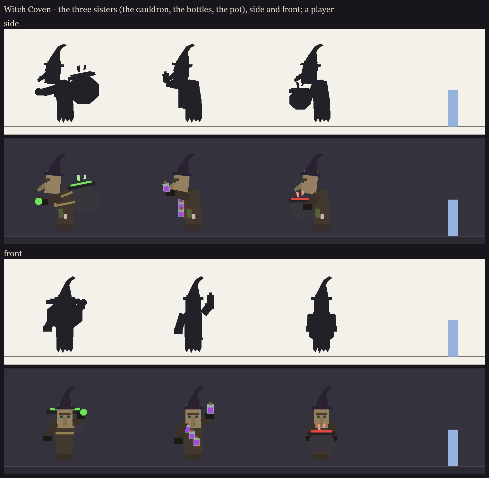

# Witch Coven redesign, step 1 (take 2): the three sisters

The direction and decisions are in [../plan.md](../plan.md). Take 1 (three body variants with a hanging cauldron, a
censer and a back-pot) is in git history; the user found its proportions weird and replaced the vessels.

**The body, the same for all three:**
- a large old villager, about 1.45x a villager (3 blocks to the top of the head; the player is 1.8), crouched in an
  old woman's stoop: the upper body leans forward on rounded shoulders, with no hump (the user's correction);
- a straight villager robe, no flare;
- a flat ragged hem hanging under it as she hovers (a 2D plane, its rags in the texture);
- vanilla's witch hat at the head's scale;
- no fingers: the sleeves end in dark cuffs.

**The vessels, the only difference between the sisters:**
1. **The cauldron:** an extra-large cauldron on her back, roped round her middle. Her sleeves are free: she
   casts and throws with them.
2. **The bottles:** a diagonal shoulder belt of large potion bottles, and one held up in her sleeve, ready to throw.
3. **The pot:** a pot held out in front of her in both sleeves.

Each is shown in one role colour (green healer, purple curser, red bomber). In the fight every sister takes every
role, and only the colour of the smoke and liquid changes.

The faces are placeholders in the vanilla villager/witch layout. Making them more interesting is step 2.

Regenerate with `python tools/art/bosses/coven_lineup.py`.
