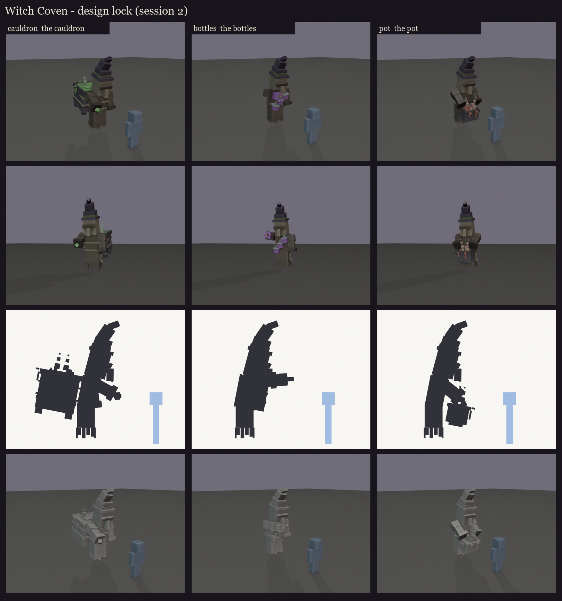
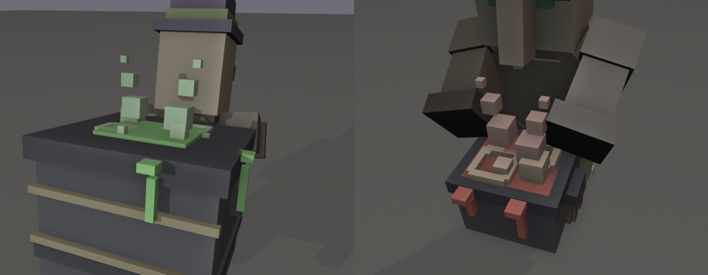
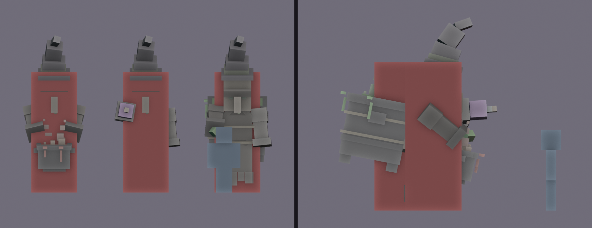
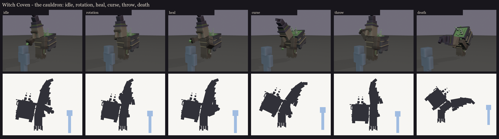
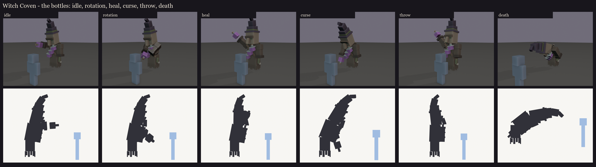
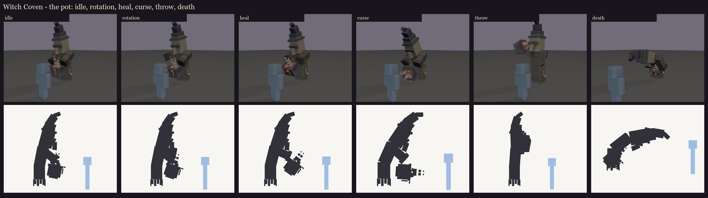

# Witch Coven redesign, session 2: design lock

**Approved by the user on 2026-10-11**, after the last fix: the cauldron's brew now fills its whole mouth.

The direction approved after the set ([../s3_set](../s3_set/README.md)) is rebuilt as a rig, one body for all three
sisters:
- the face: F1's eyes, F2's drooping brow, F3's long nose with its mole;
- vanilla's villager head (12 x 14 x 12) and robe (13 x 10 at the base) at 1.45x, snapped to whole texels;
- vanilla's witch hat;
- an old stoop;
- free cuffed sleeves (no hands);
- a ragged hem hanging as she hovers.

They differ only by their vessels:
- **the cauldron:** vanilla's cauldron grown to 24 x 20 x 22, roped to her back (each rope a loop round her middle and
  the whole cauldron: across her chest, along her sides, down the cauldron's sides through its handles, across its back);
- **the bottles:** a shoulder belt of three bottles and one in her sleeve;
- **the pot:** an iron pot held at her waist in both sleeves.

## The brew

Both the cauldron and the pot bubble. Each vessel's lip is an open iron rim (2 texels on the cauldron), and the brew
fills the whole mouth inside it, a texel under the rim's top, domed in the middle. Bubbles of
three sizes break out of it, two popping rings sit on its surface, and glowing drips run over the lip and down the
side. Small puffs of steam rise, shrinking as they go. All of it is on the `glow_brew` bone, so it glows in game and
changes colour with the role.

## Size and hitbox

- **Model:** about 1.8 blocks wide and 4.1 tall to the tip of the hat (3.3 to the top of the head). The cauldron
  witch is 3 blocks deep with her cauldron; the player is 1.8 tall.
- **Hitbox:** one invisible `ob_hitbox` bone per witch, the same for all three: 1.25 x 3.3 x 1.25 blocks, from the
  floor to the top of the head, over the robe, torso and head.
  - The hat, the sleeves and the vessel stay outside it, so the cauldron is never a free target from behind.
  - It's one box per witch, so a sweep can't hit a witch twice.

## Bones (BetterModel names)

The same on every sister: `robe_lower` (the hem planes, herbs, a bone charm), `torso` (the stoop), `h_head` (the face
and hat; renamed to the `hi` tag at ship time, as the other bosses' heads were), the hat's tiers, `arm_right` and
`arm_left` (each sleeve pivots at its shoulder), and `vessel`.
- **Glow bones:** `glow_brew` (the brew and steam) and, on the cauldron witch, `glow_cast` at her sleeve.
- **The pot witch** has two vessel bones: `pot_carry` swings from the shoulders (to lift the pot for the throw), and
  `vessel` tips about the pot itself (to pour).

**Counts:** 62-91 cubes and 12-13 bones with geometry per witch, still about 37 displays for the coven, since the new brew detail shares its bones (Brood Mother is
72). Full list: [parts.md](parts.md).

## Key poses

These are the fight's moments, posed from the rig for each sister with her own vessel. They are silhouettes for the
design, not animation.

- **Idle**
- **Role rotation:** she strikes her vessel. The cauldron witch raps its rim over her shoulder, the bottle witch
  clinks her bottles, the pot witch raps the pot.
- **Heal:** brew poured towards her sister.
- **Curse:** cast down onto the marked floor, leaning in.
- **Throw (bomber):** wound up to hurl, the throwing sleeve raised high and out to the side, clear of the face. The
  pot witch heaves the whole pot up beside her head with both sleeves.
- **Death:** she slumps forward.

Walking, hovering and the brew changing colour are left for the animation session.

Regenerate with `python tools/art/bosses/coven_s2.py`. The editable blockouts with their hitboxes are in each
sister's folder.
