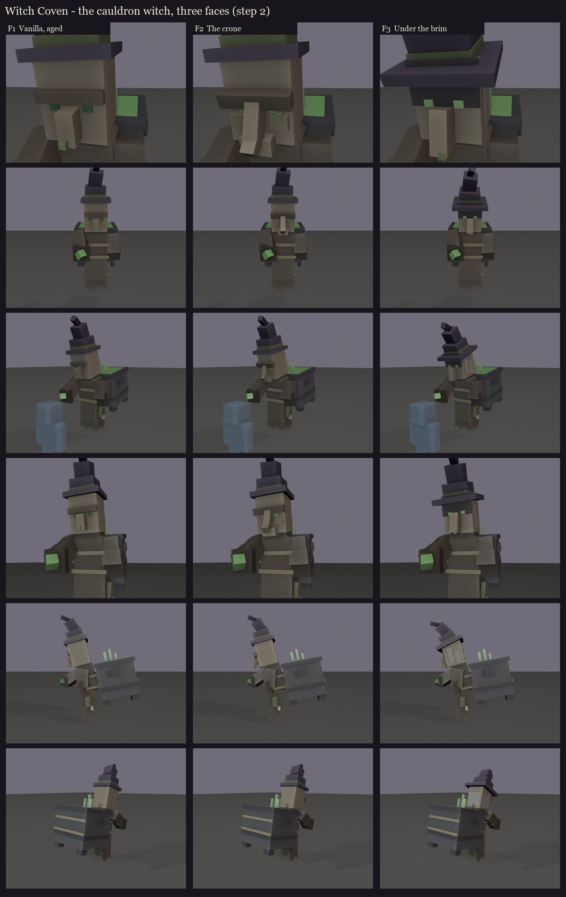

# Witch Coven redesign, step 2: the cauldron witch, character study

The line-up ([../s1_lineup](../s1_lineup/README.md)) set the body and the vessels. This is the first 3D model: the
cauldron witch, built from vanilla's own parts at 1.45x, read from the 26.2 client.

**From vanilla:**
- the villager head (8x10x8), nose (2x4x2) and robe (8x20x6);
- the witch's mole;
- the witch's hat (brim, three tiers set back and bent further each, so the tip curls back), its tiers made taller to
  read at this size;
- vanilla's cauldron, grown to about 1.5 blocks: square, with a lip, notched sides and stubby legs.

**Ours:**
- an old woman's stoop (the upper body leans forward on the hips);
- free sleeves with dark cuffs (no hands), the right one raised and casting;
- a ragged hem hanging as she hovers;
- the cauldron roped to her back, its brew glowing in the role colour (green: the healer);
- about 65-70 cubes.

**Three faces on the same body** ("the vanilla witch face, but more interesting"):

| | Face | |
|---|---|---|
| F1 | **Vanilla, aged** | vanilla's face exactly at 1.45x, with a heavier brow. Instantly a Minecraft witch, the least new. |
| F2 | **The crone** | a long nose hooked down at the tip with two moles, a drooping brow, a jutting chin, small eyes lit faintly green. The most character, the most caricature. |
| F3 | **Under the brim** | a wider brim pulled down and tipped forward, the upper face in its shadow, only two lit eyes and the long nose showing, grey hair hanging from under the hat. The most menacing, and the lit eyes can take the role colour. |

Colours are flat blockout colours; the faces, robe rags, ropes and iron get painted in session 5.

Regenerate with `python tools/art/bosses/coven_study.py`.
