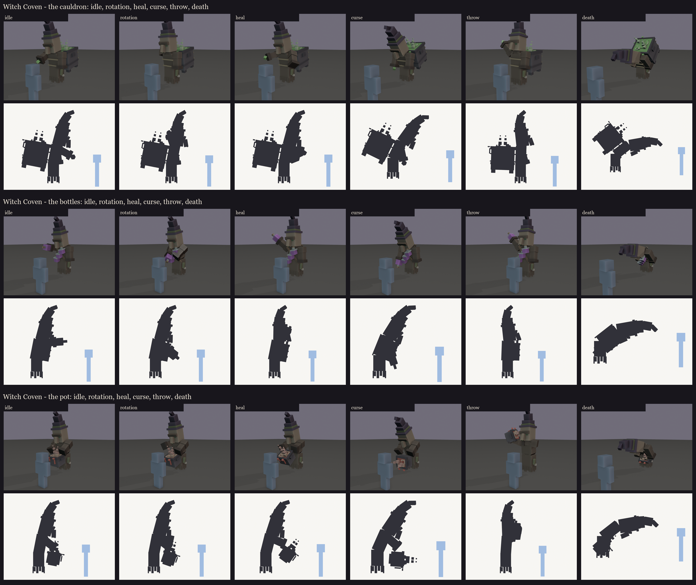
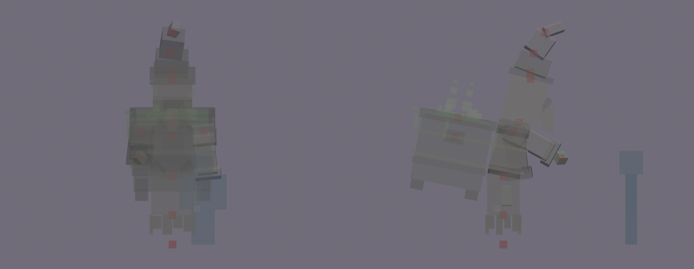

# Witch Coven redesign, session 3: rig and pose test

This makes the approved design lock ([../s2_design](../s2_design/README.md)) ready to move and to see in game:
- the joints are checked;
- the bone names are checked against BetterModel's tags;
- the drawing cost is counted;
- six test poses are set per sister;
- each material gets a flat colour, so BetterModel can show the coven before texturing. The brew, its bubbles and
  steam, and the cauldron witch's casting light are drawn full-bright.



| Pose | What it tests |
|---|---|
| idle | hovering in her stoop |
| rotation | the role swap: she strikes her vessel (the rim rapped, the bottles clinked, the pot rapped) |
| heal | brew poured towards her sister |
| curse | leaning in, casting onto the marked floor |
| throw | the bomber's wind-up: the sleeve high and out to the side; the pot heaved beside her head |
| death | the slump |

## Rig checks ([rig_report.json](rig_report.json))

- **Pivots:** every bone with cubes pivots inside its joint. Each sister's `pivots.md` gives every bone's distance
  to its own cubes.
  - Each sleeve turns at its shoulder.
  - The head turns at the neck.
  - The torso turns at the waist for the stoop.
  - Each hat tier turns at its base, so the tip can sway.
  - The pot witch's `pot_carry` turns at the shoulders and her `vessel` about the pot.
  - Two fixes made on the way:
    - The robe's chamfer helper had made a bone of its own. Its cubes now sit on the torso, which saves a bone.
    - The held bottle's base now sits in the cuff (its pivot was 3 texels past the sleeve).

  
- **BetterModel tags:** only the intended bones carry one:
  - `h_head` follows the look;
  - `glow_brew` and `glow_cast` are drawn full-bright;
  - `ob_hitbox` is the invisible hitbox.
- **Drawing cost:** 11-12 bones with cubes per sister (62-91 cubes), drawn as **15, 18 and 14 display entities**: 47
  for the coven. (Session 5 gave the bottle witch's liquid two glow bones of its own, so the role tint can colour it
  alone: 15, 22 and 14, 51 for the coven. Her `bottle_held` bone now holds only the glass and cork, so its pivot,
  still at the cuff where the bottle swings, sits a few texels from its own cubes.)
  - That's more than session 2's estimate of 37: a cube turned on two axes needs a display of its own.
  - Brood Mother alone draws 71, Volley 56.
- **Load test:** on the second test server, BetterModel loaded the three rigs with the shipped models and no
  warnings ("7 of models are loaded successfully"). They were then taken off that server again, since its models
  folder must hold only shipped models for pack builds.

## In game

The review models have flat material colours and no texture yet. They are in `run/plugins/BetterModel/models` (your
server on port 25565), aren't shipped, and hold each pose as an animation:

```
/bm reload
/bm test occultech_coven_cauldron_rig idle
/bm test occultech_coven_bottles_rig throw
/bm test occultech_coven_pot_rig heal
```

The poses are `idle`, `rotation`, `heal`, `curse`, `throw` and `death`; `/bm spawn <model>` places one to walk round.

**Things to check in game:**
- **The poses:** each looks like the render above. If a sleeve swings the wrong way, the animation sign convention
  needs flipping for those bones.
- **Size:** about 3.3 blocks to the top of the head and 4.1 to the hat's tip, against you.
- **The face:** F1's eyes, F2's brow and F3's nose read at combat distance.
- **The brew:** it glows full-bright and reads as bubbling, on the cauldron and the pot.
- **The hem planes:** they don't flicker.

Regenerate with `python tools/art/bosses/coven_s3.py`. It also copies the review models to your server.

Next, session 4: UVs at one texel per unit, a packed atlas per sister (or one shared atlas, since the bodies are the
same), and a flat colour per material zone, then a grey-value check.
