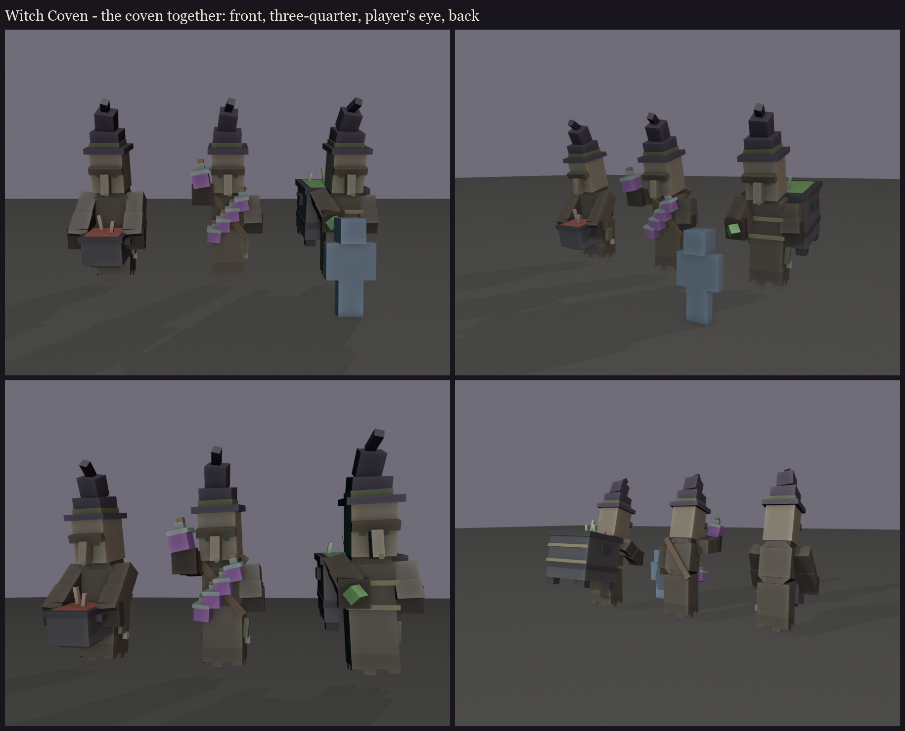
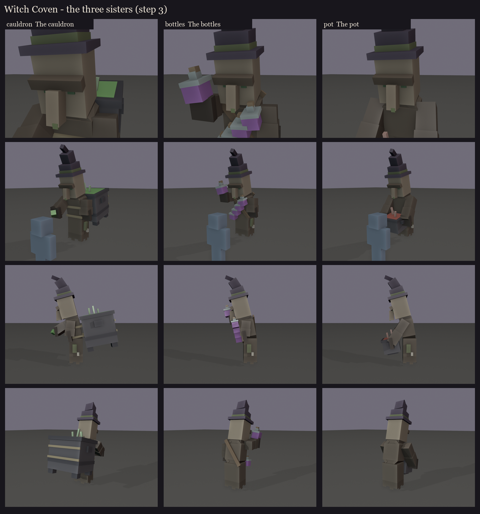

# Witch Coven redesign, step 3: the three sisters

**The face, picked from the character study ([../s2_study](../s2_study/README.md)):**
- F1's eyes (vanilla's, at 1.45x);
- F2's drooping brow;
- F3's long nose with the mole at its tip;
- under vanilla's witch hat.

**The body** is the study's, the same for all three: the villager head and robe at 1.45x, an old stoop, free cuffed
sleeves (no hands), and a ragged hem hanging as she hovers. Each witch is 51-66 cubes, about 180 for the coven.

**The vessels**, each shown in one role colour (in the fight every sister takes every role):

| Sister | Vessel | Shown as |
|---|---|---|
| **The cauldron** | vanilla's cauldron grown to about 1.5 blocks, roped to her back; her right sleeve casts | green, the healer |
| **The bottles** | a belt from her left shoulder to her right hip carrying four large potion bottles, one more raised in her sleeve | purple, the curser |
| **The pot** | an iron pot held at her waist in both sleeves, low enough that the face and chest stay clear | red, the bomber |

Colours are flat blockout colours. The robe rags, ropes, glass, iron and faces get painted in session 5.

Regenerate with `python tools/art/bosses/coven_set.py`. The editable models are in `cauldron/`, `bottles/` and `pot/`.
