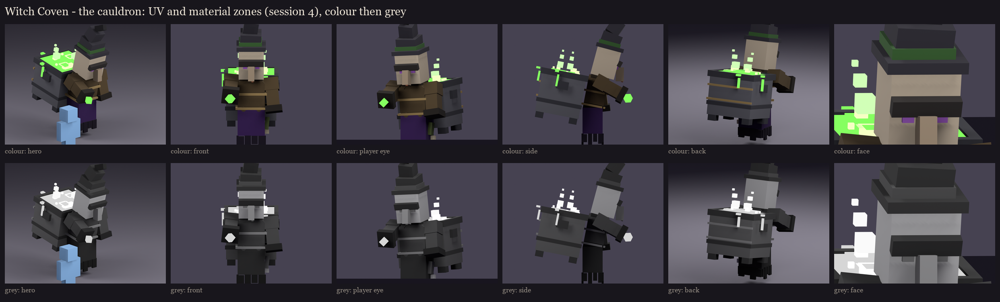
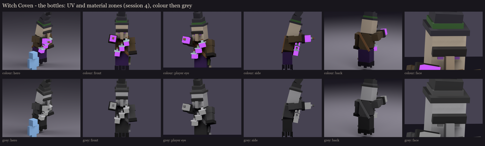
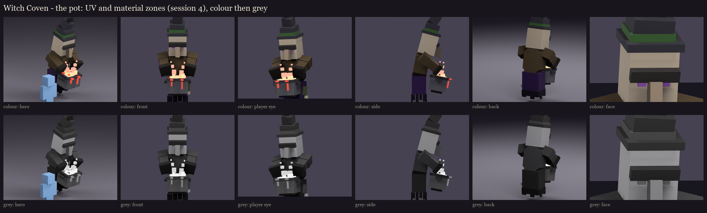

# Witch Coven redesign, session 4: UV and material blocking

On top of the session 3 rigs ([../s3_rig](../s3_rig/README.md)):
- **One shared atlas** for all three sisters, 256 x 256 (145 rows used, about half full, so session 5 has room).
  Every visible face is at one texel per model unit (16 per block, the vanilla density), with a 1-pixel border on
  each island against seams.
- **Shared where truly identical:** the body, head, hat and sleeves are the same cubes on all three sisters, so they
  use the same islands; a left sleeve shares its right twin's. The vessels get islands of their own. That's 802
  islands for the coven: 501, 344 and 427 used by the cauldron, the bottles and the pot.
- **Buried faces left out:** 29, 12 and 13 faces that sit inside another cube of the same bone get no texture and are
  never drawn.
- **A flat colour per material zone, tied to vanilla's witch:**
  - a purple robe under a brown coat and sleeves;
  - a near-black hat with a green band;
  - pale grey-beige skin, purple eyes, a brown mole;
  - vanilla's cauldron grey for the iron.

  The brew, its foam and steam are the only saturated colours, in the role colour, and are drawn full-bright.
- **The in-game review rigs** (`occultech_coven_<vessel>_rig`) now carry this atlas, so the pixel size can be judged
  in game. They are in `run/plugins/BetterModel/models`. On the second test server they loaded with the shipped
  models and no warnings, and were then taken off it again.

## The value check

The grey rows are the same renders with the colour taken out: the body stays dark and calm, and the face and the
brew are what you see first. Every pair of neighbouring zones is at least 12 apart in lightness. Six pairs were
too close at first and were spread:
- the hem under the robe;
- the collar on the coat;
- the nose on the face;
- the hat's tip;
- the leather strap on the coat (it became a lighter tan);
- the iron next to the coat (lifted to vanilla's cauldron grey).

| Zone | Colour | Lightness | | Zone | Colour | Lightness |
|---|---|---|---|---|---|---|
| robe | 52, 24, 78 | 15 | | hat | 46, 44, 52 | 18 |
| robe hem | 16, 5, 27 | 3 | | hat tip | 17, 16, 21 | 5 |
| coat | 78, 64, 42 | 28 | | band | 52, 88, 44 | 34 |
| collar | 44, 36, 23 | 15 | | iron | 94, 94, 100 | 40 |
| cuff | 30, 25, 20 | 9 | | iron dark | 54, 54, 60 | 23 |
| skin | 171, 159, 141 | 66 | | rope | 146, 124, 82 | 53 |
| nose | 140, 125, 106 | 53 | | strap | 122, 88, 54 | 40 |
| mole | 117, 71, 47 | 35 | | glass | 178, 202, 204 | 80 |
| brow | 46, 42, 40 | 17 | | cork | 126, 96, 62 | 43 |
| eye | 138, 84, 164 | 45 | | brew (green / purple / red) | 120, 235, 90 / 176, 84, 230 / 232, 76, 60 | 84 / 53 / 55 |

Full list: [uv_report.json](uv_report.json). The atlas: [occultech_coven.png](occultech_coven.png), enlarged in
[atlas_preview.png](atlas_preview.png).

## For session 6: the brew changes colour in the fight

Every sister takes every role, so the brew must switch between green, purple and red during the fight. In this atlas
each vessel's brew is painted in one role colour for review. Session 6 picks how it changes in game. Either the brew
is painted neutral and tinted per role (if BetterModel can tint one bone), or each vessel carries three brew bones,
one per colour, and the fight shows the right one. The second always works.

Regenerate with `python tools/art/bosses/coven_s4.py`. It also copies the review rigs to your server.

Next, session 5: texture painting over this atlas.
