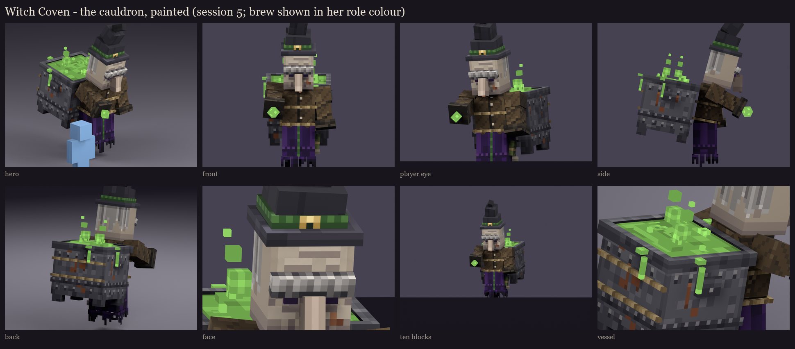
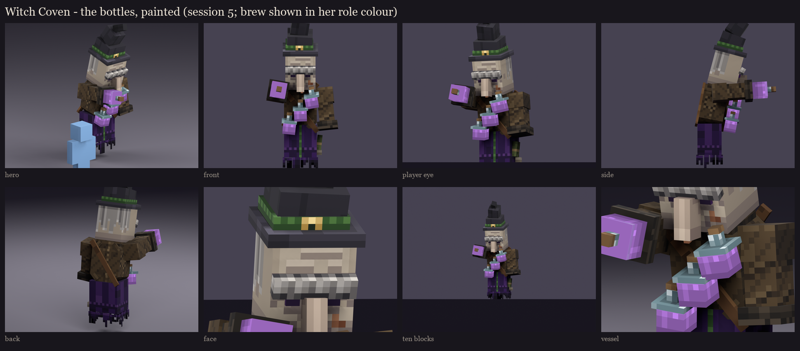
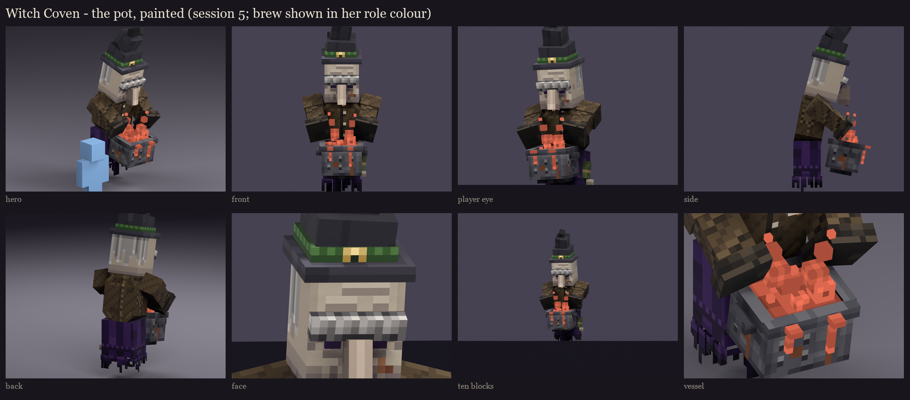

# Witch Coven redesign, session 5: texture painting

This paints session 4's layout ([../s4_uv](../s4_uv/README.md)): one shared 256 x 256 atlas for the three sisters, at
one texel per unit. Each ramp is a range of shades of one colour, darkest to lightest. Every ramp is hue-shifted:
shadows lean cool or violet, lights lean warm. Session 4's flat colour is one shade of each ramp. Detail comes in
clusters (no single-pixel speckle), and there is no painted light direction: ambient occlusion is baked from the real
geometry. Shared body islands take their occlusion from the body alone, so one sister's ropes or pot never print on
another's robe.





## Take 2: more refined (after the user's review)

The user asked for more refined and detailed textures, especially the cauldrons, fabric and skin; brew colours that
sit with the muted clothes; better potion bottles; and bubble textures. Every ramp now has 9-11 close shades instead
of 4-6, so detail can be subtle rather than speckled.

**Fabric:**
- **Robe:** wool in soft rounded folds (a lit ridge, a shaded valley), darker towards the hem, a stitched trim above
  it, and vanilla's green stripe down its front with a stitch every third row.
- **Hem:** torn strips of different lengths, moth holes, a darker torn edge, and a lit seam where it hangs.
- **Coat:** a fine diagonal twill, light grime, worn top edges, stitched side and back seams, horn buttons down the
  front opening, and a stitched patch on one side.
- **Sleeves and cuffs:** creases winding down the sleeves, each with a lit fold; cuffs with a seam and frayed threads.

**Skin:**
- forehead creases, each with a lit edge;
- dark eye sockets and bags under the eyes, and crow's feet;
- lit cheekbones over hollow cheeks, deep smile lines from the nose, and the jaw in shadow;
- a wart on her cheek, and age spots;
- the nose: a lit bridge, a faintly reddened tip and nostrils (first tried in a stronger red, which read as a
  carrot);
- grey hair in strands of three greys with lighter tips, and bushy grey brows with dark roots.

**Hat:** felt with soft mottling, a dent down the cone, a lit brim edge, a woven green band and a brass buckle.

**Cauldron and pot:**
- hammered iron in vanilla's greys;
- a lit top edge and a seamed border on each panel;
- rivet rows, with rust running down from some of them, plus a few rust blooms;
- soot rising from the base;
- a rim worn bright on top, and a dark wet inner wall above the brew;
- rivets on the band, and a rivet in each ear.

**Bottles:**
- the brew deeper towards the bottom, with a bright surface, a reflection down the glass and a glint;
- darker, see-through glass shoulders and necks with bright edges (they first read as white lids);
- corks with a darker ring.

**Bubbles:** each bubble has a bright rim round a darker film and a highlight at its top corner, on the bubble cubes
and painted into the brew's surface. Popping rings are painted into the surface too. As thin bars of geometry they
drew bright lines across the brew, so those cubes are gone.

**Rope and strap:** the rope is three twisted strands; the strap is leather with stitches along both edges.

**Colour harmony:** the role colours are now potion tones, a mossy green, a heather purple and a brick red: (150,
214, 108), (176, 124, 212) and (220, 112, 88), multiplied into the neutral brew. Take 1's near-neon colours fought
the muted clothes. The robe and coat gained a little richness to meet them.

## The brew is painted neutral

Every sister takes every role, so the brew is painted in neutral greys, carrying only its shading:
- the brew's soft blotches;
- the foam;
- the drips;
- the rising steam puffs;
- the bottles' liquid;
- the cauldron witch's cast.

In the fight, BetterModel tints those bones the role colour. Its per-bone tint (`TrackerUpdateAction.tint(rgb)`
applied through a bone filter, which is also the MythicMobs `tint` mechanic's `part` filter) multiplies the texture
by the colour. Checked in BetterModel 3.5.0.

**One rig change made this work:** the bottle witch's liquid shared a bone with its glass, cork and strap, which a
tint would have coloured too. It now has glow bones of its own: `glow_brew` on the belt and `glow_brew_held` in her
sleeve. The coven now draws 51 displays (15, 22, 14).

The renders and the in-game review rigs show each sister with her brew already tinted: green, purple and red. The
shipped model will carry the neutral atlas ([occultech_coven.png](occultech_coven.png)), and session 6 wires the tint.

**Fixed on the way (take 1):**
- The grey hair started on the front of the head's sides: each side face's texture runs the other way.
- Dark brows read as a moustache, so they became grey.
- The brew's first pattern looked like a circuit board, and became soft blotches.

## In game

The review rigs on your server (`occultech_coven_cauldron_rig`, `_bottles_rig`, `_pot_rig`) carry this paint. On
the second test server they loaded with the shipped models and no warnings.

```
/bm reload
/bm test occultech_coven_cauldron_rig idle
```

Regenerate with `python tools/art/bosses/coven_s5.py`. It also copies the review rigs to your server.

Next, session 6:
- wire the role tint (and check it doesn't fight BetterModel's red damage flash);
- phase and damage variants;
- readability at night and under the hit tint.
