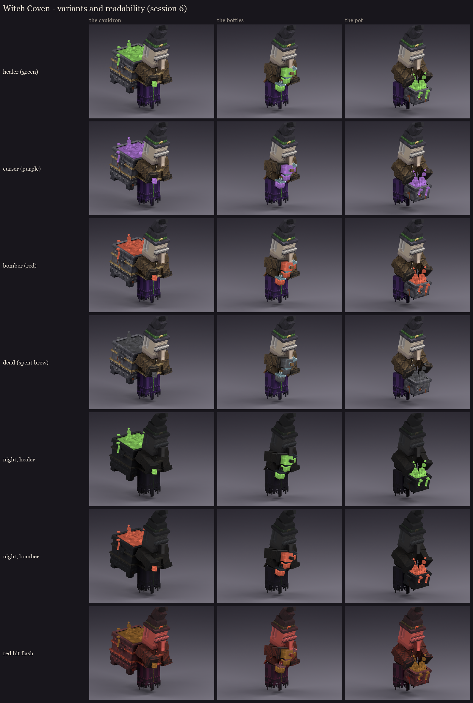
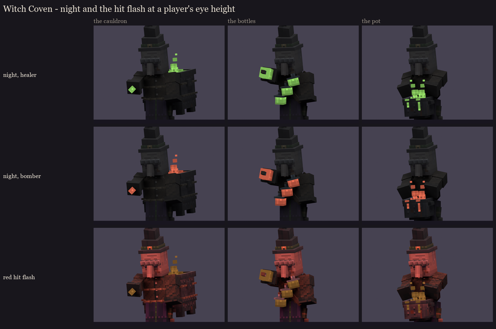

# Witch Coven redesign, session 6: variants and readability

The coven has no phases. Its variants are the **roles**: every sister takes every role in turn, and her brew shows
which. Session 5 painted the brew in neutral greys. In the fight, BetterModel's per-bone tint multiplies the role
colour into it, so there is no texture swap and no extra bones.

| Role | Tint (RGB) |
|---|---|
| healer | green 150, 214, 108 |
| curser | purple 176, 124, 212 |
| bomber | red 220, 112, 88 |
| dead | grey 96, 96, 100: a dead sister's brew goes dull as she slumps |

**The tinted bones** are those whose names start with `glow_brew` (the brew, its foam, drips and steam, and the
bottles' liquid) or `glow_cast` (the cauldron witch's cast).

## How it works in BetterModel (checked in 3.5.0)

- **The call:** `tracker.update(TrackerUpdateAction.tint(rgb), bone -> bone.name().startsWith("glow_brew") || ...)`
  tints only those bones. MythicMobs' BetterModel `tint` mechanic does the same, with a `part` filter.
- **The hit flash** (`EntityTracker.damageTint`) tints every bone red for about 10 ticks, then sends `previousTint`.
  Each bone keeps its last tint, so the brew returns to its role colour after a hit.
- **One edge case:** if the roles rotate during a flash, the "previous" tint a bone saves is the flash's red, so its
  brew would stay red until the next rotation.
- **The rule for session 8's fight code:** re-apply the role tint about 12 ticks after every rotation (after any
  flash has ended).

## Readability

- **Roles:** each brew reads as its role from every angle. The spent grey doesn't read as a fourth role.
- **At night** (light level about 4): everything but the full-bright brew dims to a dark silhouette. The glowing brew
  is the only colour left, so "kill the green one first" still reads at a glance in the dark. The faces and robes go
  dark like any vanilla mob's.

  
- **Under the hit flash:** the whole witch reddens, and the brew shifts warm but stays the brightest thing on her.
  The flash's red here is a stand-in, multiplied like any tint.

The coven still draws 51 displays (15, 22, 14). Nothing was added for the variants.

Regenerate with `python tools/art/bosses/coven_s6.py`. Next, session 7: animation (idle, the hover, the role
rotation, each sister's heal, curse and throw timed to the fight, death).
