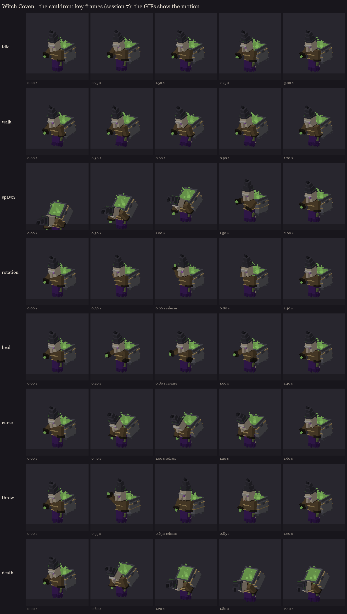
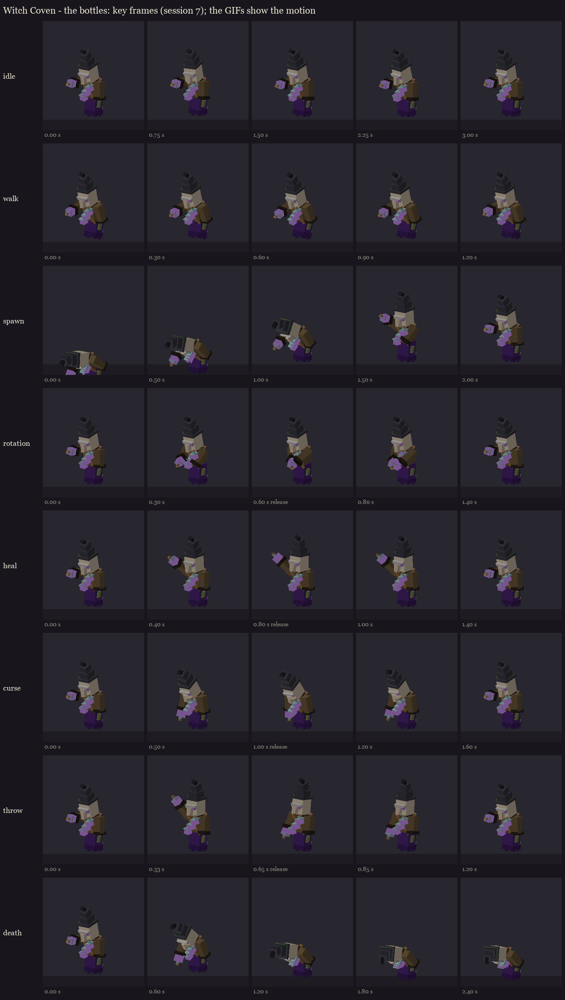
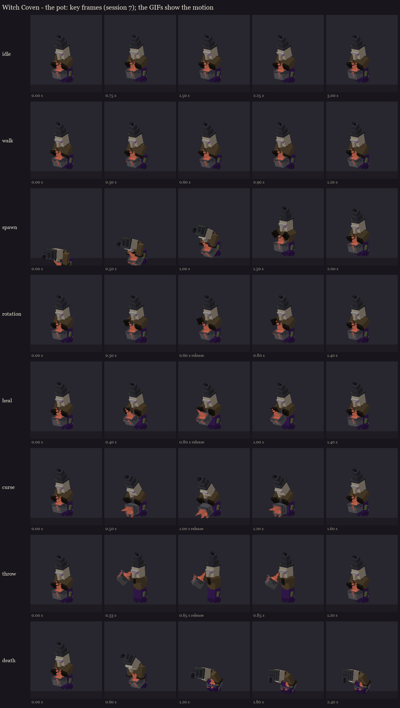

# Witch Coven redesign, session 7: animation

Eight clips per sister, each built round her own vessel, written into her review rig (`occultech_coven_<vessel>_rig`)
and later the shipped models. Timings follow `WitchCoven.java`. Animation is cosmetic: every hit and telegraph still
comes from the server.

| Clip | | Length | What happens |
|---|---|---|---|
| idle | loop | 3.0 s | the hover bob, the robe swaying, a slow look round, the hat's tip flopping, the brew pulsing |
| walk | loop | 1.2 s | the hovering glide: leaning in, the robe trailing, the sleeves dragging back, a quicker bob |
| spawn | once | 2.0 s | she rises out of the ritual circle folded over, then unfolds into her stoop |
| rotation | once | 1.4 s | she strikes her vessel (rim, bottles, pot) at **0.6 s**, and the brew swells as its colour changes |
| heal | once | 1.4 s | the wind-up, then the pour at **0.8 s** |
| curse | once | 1.6 s | she leans in and casts, trembling, through the 1-second floor warning; a flick at **1.0 s** as it lands |
| throw | once | 1.2 s | the wind-up (the sleeve high and out to the side; the pot heaved beside her head), the release at **0.65 s** |
| death | hold | 2.4 s | she slumps forward, her hover gives out and she sinks to the floor, her hat sliding, the brew settling |

The four action clips key only the bones they move. They're flagged as overrides in BetterModel, so the hover keeps
playing under them.

Key frames (the release marked), and the GIFs in each sister's `gifs/` folder:





## For session 8: the fight's timing

Each action clip has a release point: the moment its effect should land. The server starts the clip that long
before the real event, so the motion leads into it. This is the "wind-ups take real time" fix from the plan.
- **Rotation:** start 12 ticks before the roles change. Switch the brew tints at the strike (0.6 s in), and re-apply
  them about 12 ticks later (session 6: the hit flash).
- **Heal:** start 16 ticks before the heal lands.
- **Curse:** the clip starts with the floor mark (the 20-tick warning), and the curse lands at 1.0 s. Only players
  still on the mark are cursed, which makes it dodgeable (plan.md).
- **Throw:** start 13 ticks before the potion is launched from her sleeve.
- **Death:** play it when she dies, and tint her brew spent grey.

The review rigs on your server have every clip, and loaded on the second test server with no warnings:

```
/bm reload
/bm test occultech_coven_cauldron_rig idle
/bm test occultech_coven_pot_rig throw
```

The clips are `idle`, `walk`, `spawn`, `rotation`, `heal`, `curse`, `throw` and `death`. The previews are a quick
software render in flat zone colours, for judging motion only.

Regenerate with `python tools/art/bosses/coven_s7.py` (it builds on the session 5 rigs and copies the result to your
server).
